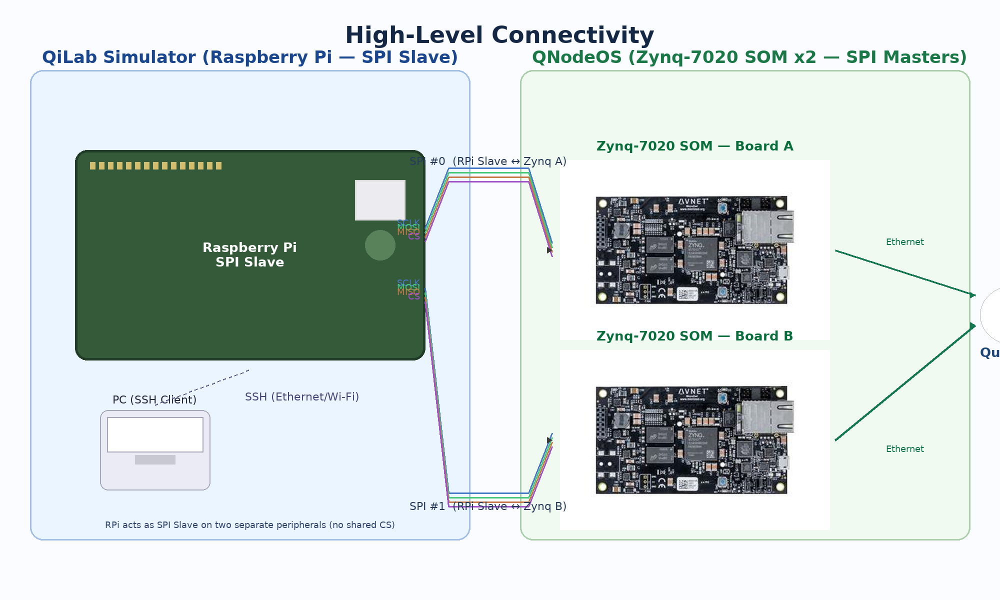

# QILab — QiLab Simulator ↔ QNodeOS (via SPI)

This repository contains a C++20 codebase for simulating and orchestrating **quantum network nodes** using a modular command/transport pipeline.  
At a high level, a **QiLab simulator** (Raspberry Pi acting as **SPI _slave_**) exchanges commands with two **QNodeOS** devices (Zynq-7020 SOMs acting as **SPI _masters_**). Each Zynq node also connects upstream to a **Quantum Network** (cloud).



> The diagram reflects two **independent SPI peripherals** on the Raspberry Pi (no shared chip select).  
> The RPi is managed over **SSH** from a developer PC.

---

## Features

- **Command pipeline** with a `CommandHandler` and `SimulatorRunner` for routing and executing operations.
- **Simulator adapters**:
  - `stim_adapter` – integrates the [Stim](https://github.com/quantumlib/stim) stabilizer simulator.
  - `mock_adapter` – a lightweight fake for tests and bring-up.
- **Pluggable transport** (mock in-tree; replace with real SPI/I/O as needed).
- **Zynq-side command node** abstraction.
- **Structured logging and fast TLS profiler** (opt-in) with unit tests.
- Fully CMake-based build with `FetchContent` for Stim and GoogleTest.

---

## Build

### Prerequisites
- CMake ≥ 3.16
- A C++20 compiler (GCC / Clang)
- Internet access on first configure (for Stim and GTest via `FetchContent`)

### Configure & build (default, Release-like)
```bash
# From repo root (this folder contains the top-level CMakeLists.txt)
cmake -S . -B build -DCMAKE_BUILD_TYPE=Release
cmake --build build -j
```

This produces:
- `build/qilab` — sample application
- `build/libqilab_lib.a` — core static library
- `build/libprofiler.a` — profiler library (used by the core; can be compiled out via flags in future)

### Build with tests
```bash
cmake -S . -B build -DCMAKE_BUILD_TYPE=RelWithDebInfo -DBUILD_TESTING=ON
cmake --build build -j
ctest --test-dir build --output-on-failure
```

> **Note:** The project’s CMake uses `FetchContent` to pull Stim (v1.15.0) and GoogleTest.  
> If you are behind a proxy, set `HTTPS_PROXY`/`HTTP_PROXY` accordingly before configuring.

---

## Run

The `qilab` executable shows a small end-to-end flow that wires up:
- transports (mocked in-tree),
- `CommandHandler`s,
- the `SimulatorRunner` using the **Stim** backend.

```bash
./build/qilab
```

You should see log output indicating that commands were dispatched and the simulation executed.

> **Hardware:** The repo currently ships with **mock** transports.  
> To drive real hardware over SPI, implement a concrete transport that satisfies the transport interface (see `src/CommandHandler/transmission.hpp`) and swap it in where the mock is constructed in `application.cpp`.

---

## Repository layout

```
src/
  CommandHandler/
    command_handler.cpp
    command_handler.hpp
    transmision_handler.hpp
  CommandNode/
    command_node.cpp
    command_node.hpp
  DataTypes/
    command_data.hpp
    commands.hpp
    responses.hpp
  Simulator/
    sim_interface.hpp
  SimulatorRunner/
    entanglement_manager.cpp
    entanglement_manager.hpp
    runnable.hpp
    simulator_runner.cpp
    simulator_runner.hpp
  logger/
    logger.cpp
    logger.hpp
    profiler.cpp
    profiler.hpp
    profiler_api.hpp
    profiler_config.hpp
test/
  CMakeLists.txt
  command_handler/
    test_command_handler.cpp
  logger/
    test_profiler_disabled.cpp
    test_profiler_enabled.cpp
  mocks/
    mock_transmission.hpp
  sample_test.cpp
docs/
  Design/
    .$MultithreadedApplication.drawio.bkp
    MultithreadedApplication.drawio
    SingleThreaded.drawio
```

Key modules:

- `src/CommandHandler/` — parsing, queuing, and dispatching of commands; mock handler for tests.
- `src/SimulatorRunner/` — runs commands against a simulator backend; includes an entanglement manager.
- `src/Simulator/adapters/` — simulator adapters (`mock_adapter`, `stim_adapter`).
- `src/CommandNode/` — node abstraction
- `src/logger/` — logger and high-performance **TLS profiler**:
  - `profiler.hpp/.cpp` (runtime), `profiler_api.hpp` (no-op macros when disabled), `profiler_config.hpp`.
- `test/` — GoogleTest-based unit tests:
  - `logger/test_profiler_enabled.cpp`, `logger/test_profiler_disabled.cpp`
  - `command_handler/test_command_handler.cpp`, plus a `sample_test.cpp`

---

## Configuration & extension

### Using Stim (TableauSimulator)
The project pins **Stim v1.15.0** and links it as `libstim` via `FetchContent`.  
See `src/Simulator/adapters/stim_adapter.hpp/.cpp` for how the simulator API is wrapped.

### Swapping transports (e.g., SPI)
`src/CommandHandler/transmission.hpp` defines a minimal transport interface:
- `receive_data(uint8_t* buffer, uint8_t length)`
- `send_data(const uint8_t* buffer, uint8_t length)`

Replace the `mock_adapter`/mock transport with a concrete SPI transport on RPi (slave) and Zynq (masters).  
Each Zynq board should talk to **its own** SPI peripheral on the RPi (no shared CS).

### Profiling (optional)
The code includes a fast, zero-overhead-when-disabled profiler with per-thread TLS buffers and free-form event logging.  
See:
- `src/logger/profiler_api.hpp` — macros (no-ops if disabled)
- `src/logger/profiler.hpp/.cpp` — runtime (steady_clock-based)
- Tests under `test/logger/`

---

## Development

### Coding style
- C++20, modern RAII, lock-free hot paths where possible.
- Unit tests via GoogleTest; build with `-DBUILD_TESTING=ON` and run `ctest`.

### Common CMake options
- `-DBUILD_TESTING=ON` — build unit tests
- `-DCMAKE_BUILD_TYPE=Debug|RelWithDebInfo|Release`
- (Future) `-DPROF_ENABLED=0` — compile profiling API to no-ops

---

## Troubleshooting

- **FetchContent fails**: check proxy env vars and your network.  
- **Linker errors referencing Stim**: wipe `build/` and reconfigure; Stim target names can change across versions—this CMake pins v1.15.0.
- **No output from tests**: ensure you configured with `-DBUILD_TESTING=ON` and ran `ctest` in the build directory.

---

## License

This repo appears to include third-party components (Stim under Apache 2.0).  
Add your project’s licensing and third-party notices here.

---

## Acknowledgments

- [Stim](https://github.com/quantumlib/stim) (stabilizer simulation)
