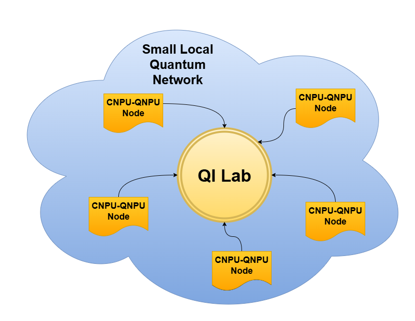
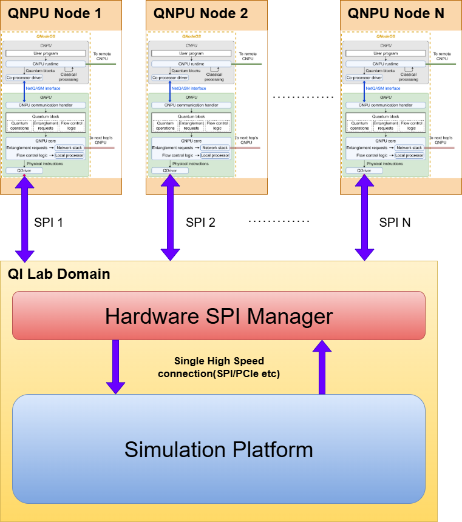

# QiLab — Quantum Network Simulation Framework

QiLab is a C++20 framework for simulating quantum internet networks with a focus on command routing, entanglement coordination, and pluggable data transport. It integrates the [Stim](https://github.com/quantumlib/stim) simulator and provides runners for simulation, entanglement, and data transmission.



## System Flow


## At a Glance
- **Simulation**: Stim-backed simulator with adapter layer (`Simulator` + `SimulatorRunners`)
- **Entanglement**: Request matching and delayed execution (`Simulator/entanglement`, `entanglement_runner`)
- **Messaging**: Lock-free broker for commands and responses (`MessageBroker`)
- **Transport**: Pluggable handlers for SPI/mock comms (`DataTransmission`)
- **Profiling/Logging**: Optional low-overhead profiler and logger (`logger`)

## Project Layout
```
src/
  DataTransmission/           # Transmission handlers, processors, runners
  MessageBroker/              # Thread-safe broker and ring buffer
  Simulator/                  # Simulator interfaces, adapters, entanglement logic
  SimulatorRunners/           # Threads driving simulator and entanglement flows
  logger/                     # Profiler and logger (optional)
  utils/                      # Thread utilities and helpers
application.cpp               # Entry point wiring runners together
docs/Design/                  # Architecture diagrams (draw.io)
test/                         # Unit/integration tests (gtest)
```

## Build
Prerequisites:
- CMake 3.14+ (project minimum)
- C++20 toolchain. By default CMake selects `aarch64-linux-gnu-g++`. Override for host builds:
  ```bash
  cmake -S . -B build \
    -DCMAKE_C_COMPILER=$(which gcc) \
    -DCMAKE_CXX_COMPILER=$(which g++)
  ```

Common configs:
- **Release** (default if unset): `-DCMAKE_BUILD_TYPE=Release`
- **Debug**: `-DCMAKE_BUILD_TYPE=Debug` (forces `ENABLE_LOGGING=ON`)
- **Options**:
  - `ENABLE_PROFILING=ON|OFF` (default ON)
  - `ENABLE_LOGGING=ON|OFF` (default OFF unless Debug)
  - `BUILD_TESTING=ON|OFF` (default ON if `ctest` desired)

Build steps:
```bash
cmake -S . -B build -DCMAKE_BUILD_TYPE=Release
cmake --build build -j$(nproc)
```

Artifacts appear in `build/`:
- Executable: `build/qilab`
- Libraries: `build/lib*.a`
- Tests (if enabled): under `build/test/`

## Run
After building:
```bash
./build/qilab
```

Runtime notes:
- `application.cpp` launches the simulator and transmission runners; the entanglement runner is wired but its thread start is currently commented out.
- Thread pinning is controlled in `application.cpp` via `SIMULATOR_CORE`, `ENTANGLEMENT_CORE`, and `TRANSMISSION_CORE` constants.
- Profiling data is dumped to CSV (`test_trace_events.csv`, `test_trace_durations.csv`) when profiling is enabled.
- Graceful shutdown: send SIGINT (Ctrl+C); threads call `on_abort()` before exit.

## Tests
Enable tests at configure time and run via `ctest`:
```bash
cmake -S . -B build -DCMAKE_BUILD_TYPE=Debug -DBUILD_TESTING=ON
cmake --build build
ctest --test-dir build --output-on-failure
```

## Diagrams & Documentation
- Architecture diagrams: `docs/Design/*.drawio`
- Core interfaces live under `src/`; headers now include detailed Doxygen comments for runners, brokers, transmission handlers, and profiling APIs.

## License
MIT License (see `LICENSE`).

---
Active development project — APIs and wiring may change.